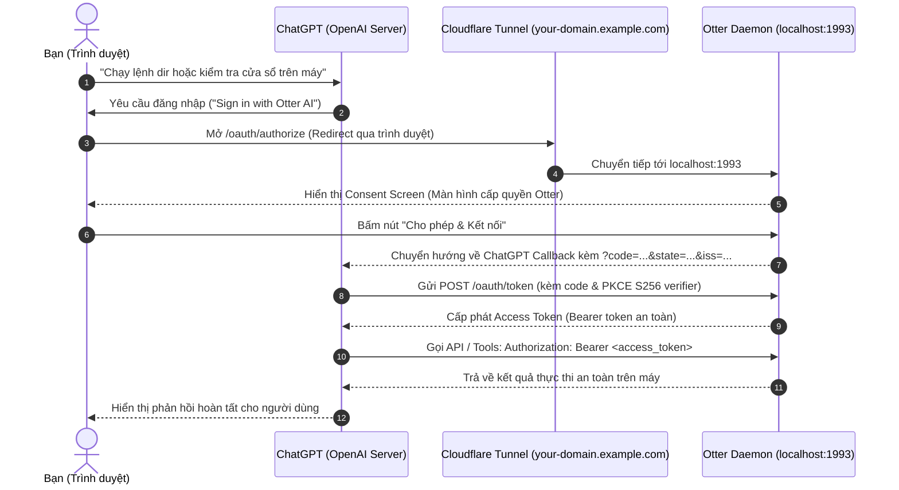

# Hướng dẫn chi tiết: Kết nối bảo mật OAuth giữa ChatGPT và Otter MCP Daemon

Tài liệu này hướng dẫn từng bước thiết lập xác thực **OAuth 2.0 / 2.1** để kết nối an toàn giữa **ChatGPT (Custom GPT Actions / OpenAI Plugins)** và **Otter MCP Daemon** đang chạy trên máy tính của bạn thông qua tên miền Cloudflare Tunnel (`https://your-domain.example.com`).

---

## 1. Mô hình kiến trúc & Luồng hoạt động



---

## 2. Kiểm tra điều kiện tiên quyết trước khi kết nối

Trước khi cấu hình trên ChatGPT, đảm bảo 2 tiến trình sau đang chạy trên máy tính của bạn:

### 2.1. Otter Daemon
Đang chạy trên cổng `1993`:
```bash
bun dev
```

### 2.2. Cloudflare Tunnel
Đang chạy để public cổng `1993` ra tên miền công khai:
```bash
cloudflared tunnel --url http://127.0.0.1:1993
```

### 2.3. Kiểm tra các Endpoint công khai hoạt động tốt
Bạn có thể mở trình duyệt hoặc dùng `curl` kiểm tra nhanh:
- **OpenAPI Schema**: `https://your-domain.example.com/openapi.json` (Trả về định nghĩa các tool).
- **OAuth Discovery**: `https://your-domain.example.com/.well-known/oauth-authorization-server` (Trả về siêu dữ liệu cấu hình OAuth).
- **Protected Resource**: `https://your-domain.example.com/.well-known/oauth-protected-resource` (Đặc tả RFC 9728 cho MCP).

---

## 3. Hướng dẫn từng bước cấu hình Custom GPT trên ChatGPT

Đây là cách phổ biến và tiện lợi nhất để điều khiển máy tính trực tiếp từ giao diện ChatGPT Plus / Team / Enterprise.

### Bước 1: Mở trình tạo GPT (GPT Builder)
1. Đăng nhập vào [ChatGPT](https://chatgpt.com/).
2. Nhấn vào mục **Explore GPTs** ở thanh điều hướng bên trái.
3. Nhấn nút **+ Create** (ở góc trên bên phải) để tạo một Custom GPT mới.
4. Chuyển sang tab **Configure**.

---

### Bước 2: Điền thông tin cơ bản cho GPT
- **Name**: `Otter PC Assistant` (hoặc tên tùy bạn thích)
- **Description**: `Trợ lý AI điều khiển máy tính cá nhân an toàn qua Otter MCP Daemon`
- **Instructions**:
  ```text
  Bạn là Otter PC Assistant, trợ lý AI cá nhân kết nối trực tiếp với máy tính của người dùng thông qua Otter MCP Server.
  Khi người dùng yêu cầu thực thi tác vụ:
  1. Với lệnh dòng lệnh hoặc kiểm tra file: Gọi tool execute_terminal_command hoặc read_file, write_file.
  2. Với tương tác trình duyệt: Gọi tool browser_navigate, browser_read_page, browser_click,...
  3. Với desktop: Gọi tool list_windows hoặc get_desktop_screenshot.
  Luôn thông báo rõ ràng trước khi thực hiện các tác vụ can thiệp hệ thống.
  ```

---

### Bước 3: Tạo Action và nhập OpenAPI Schema
1. Cuộn xuống cuối trang cấu hình, tìm mục **Actions** và nhấn **Create new action**.
2. Tại ô **Schema**, chọn nút **Import from URL**.
3. Điền URL sau vào ô pop-up:
   ```text
   https://your-domain.example.com/openapi.json
   ```
4. Nhấn **Import**. ChatGPT sẽ tự động nạp danh sách các API & Tools của Otter (Terminal, File, Desktop, System Picker, Bookmarks,...).

---

### Bước 4: Thiết lập phương thức bảo mật OAuth
1. Ngay bên dưới phần Schema, tại mục **Authentication**, nhấn chọn biểu tượng cây bút (hoặc nút **Edit** / cấu hình).
2. Chọn **Authentication Type**: `OAuth`.
3. Điền chính xác các trường thông tin sau:

| Tên trường | Giá trị cần điền | Ghi chú |
| :--- | :--- | :--- |
| **Client ID** | `chatgpt_otter` | Tên định danh (bạn có thể đặt tùy ý) |
| **Client Secret** | `otter_secret_key_123` | Mật khẩu bí mật (bạn có thể đặt tùy ý) |
| **Authorization URL** | `https://your-domain.example.com/oauth/authorize` | Trang Consent Screen cấp quyền |
| **Token URL** | `https://your-domain.example.com/oauth/token` | Endpoint đổi mã lấy Bearer token |
| **Scope** | `all` | Phạm vi quyền hạn |
| **Token Exchange Method** | `Default (POST Request)` | Phương thức gửi payload chuẩn của OpenAI |

4. Nhấn **Save** để lưu cấu hình xác thực.

---

### Bước 5: Lưu và xuất bản GPT
1. Nhấn nút **Create** hoặc **Update** ở góc trên bên phải màn hình.
2. Chọn quyền riêng tư: **Only me** (Dành riêng cho bạn) hoặc **Anyone with a link** (Chia sẻ cho team).
3. Nhấn **Confirm**.

---

## 4. Trải nghiệm thực tế & Cấp quyền lần đầu

1. Mở cửa sổ chat với Custom GPT bạn vừa tạo.
2. Gõ lệnh thử nghiệm:
   > *"Kiểm tra danh sách các cửa sổ ứng dụng đang mở trên máy tính của tôi"*
3. ChatGPT sẽ nhận diện công cụ cần quyền và hiển thị thông báo:
   ```text
   Sign in to your-domain.example.com
   ```
4. Nhấn nút **Sign in**:
   - Trình duyệt sẽ mở một tab mới dẫn tới trang **Consent Screen** của Otter: `https://your-domain.example.com/oauth/authorize`.
   - Bạn sẽ thấy giao diện Dark Mode hiển thị các quyền hạn:
     - ⚡ Thực thi các lệnh terminal console trong workspace an toàn
     - 📂 Đọc và ghi tệp tin dự án khi có sự yêu cầu từ bạn
     - 🌐 Tự động hóa tác vụ duyệt web qua Chrome Extension
5. Nhấn nút **"Cho phép & Kết nối"**:
   - Otter Daemon tự động sinh mã ủy quyền an toàn một lần (`code`), gắn kèm định danh `iss` chống giả mạo theo chuẩn **RFC 9207**.
   - Trình duyệt tự động chuyển hướng về ChatGPT.
   - ChatGPT backend ngầm gửi yêu cầu tới `/oauth/token` để nhận Bearer token và lưu lại cho phiên làm việc.
6. Quay lại màn hình chat: ChatGPT sẽ lập tức chạy lệnh và trả về kết quả các cửa sổ đang mở trên desktop của bạn!

---

## 5. Quản lý Token & Thu hồi quyền (Security Best Practices)

- **Vị trí lưu trữ Token**: Token của bạn được tự động khởi tạo và lưu bảo mật tại:
  - Windows: `C:\Users\<Tên_Bạn>\.otter\auth.token`
  - macOS / Linux: `~/.otter/auth.token`
- **Tùy biến Token qua môi trường**: Bạn có thể đặt cố định khóa API của riêng mình trong file `.env`:
  ```bash
  OTTER_API_KEY=khoa_bao_mat_cua_rieng_ban_12345
  ```
- **Cách thu hồi quyền (Revoke)**:
  - Nếu muốn ngắt kết nối ChatGPT ngay lập tức: chỉ cần xóa file `~/.otter/auth.token` hoặc thay đổi giá trị `OTTER_API_KEY` rồi khởi động lại `bun dev`. Mọi Access Token cũ được ChatGPT lưu sẽ lập tức bị từ chối với mã lỗi 401.

---

## 6. Xử lý sự cố thường gặp (Troubleshooting)

### 1. Lỗi "Could not fetch OpenAPI spec" khi Import URL
- **Nguyên nhân**: Cloudflare Tunnel chưa chạy hoặc cổng 1993 chưa mở.
- **Khắc phục**: Mở trực tiếp `https://your-domain.example.com/openapi.json` trên trình duyệt xem có ra dữ liệu JSON không.

### 2. Bấm "Cho phép & Kết nối" nhưng ChatGPT báo lỗi "Error during OAuth flow"
- **Nguyên nhân**: Sai lệch URL Authorization hoặc Token URL.
- **Khắc phục**: Đảm bảo bạn đã điền đúng `https://your-domain.example.com/oauth/authorize` và `https://your-domain.example.com/oauth/token` (có chữ `s` trong `https`).

### 3. Lỗi 401 Unauthorized khi gọi tool
- **Nguyên nhân**: Token trong file `~/.otter/auth.token` bị xóa hoặc đã thay đổi `OTTER_API_KEY`.
- **Khắc phục**: Nhấn vào biểu tượng cấu hình Action của GPT trên ChatGPT, chọn **Sign out**, sau đó thử lại lệnh để ChatGPT thực hiện lại quy trình ủy quyền OAuth mới.
